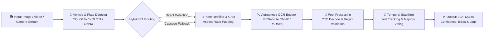
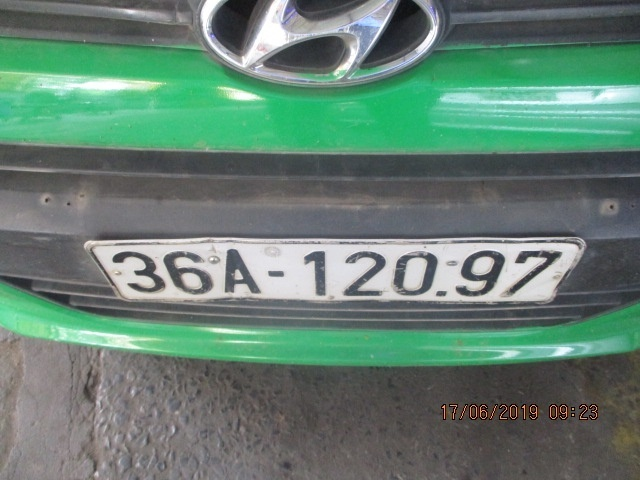
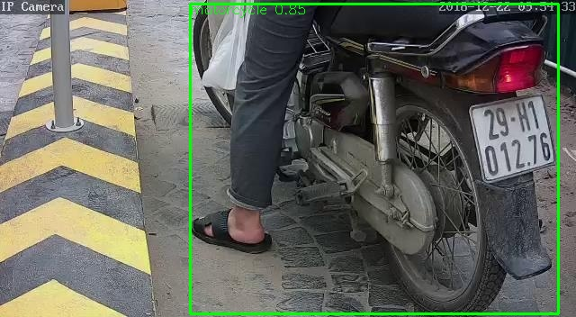
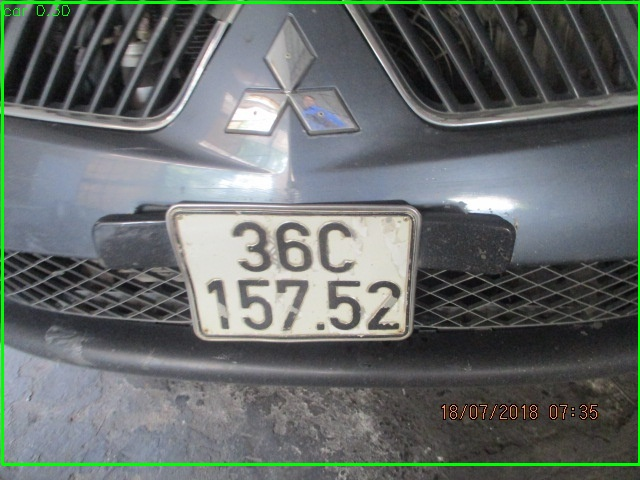
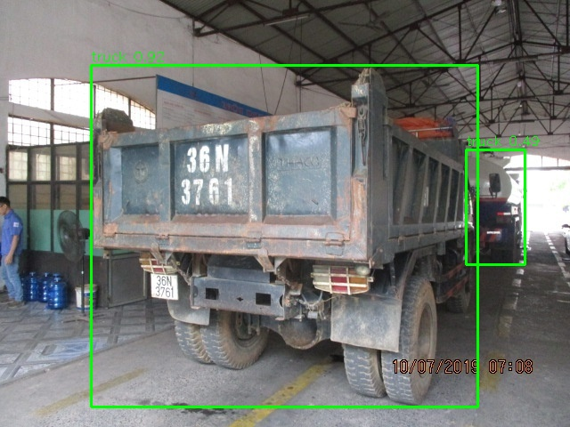

# 🚗 Vietnamese License Plate Recognition Pipeline — End-to-End Edge AI System

<p align="center">
  
  
  
  
  
  
</p>

An end-to-end Automatic License Plate Recognition (**ALPR**) system tailored specifically for Vietnamese vehicle plates. The pipeline integrates state-of-the-art deep learning architectures (**YOLO11**, **LPRNet**, and **PARSeq**) with embedded deployment optimizations for **Raspberry Pi 5 CPU** (zero heavy dependencies) and **Laptop GPU**.

---

## 📌 Key Highlights

**Documentation & Data:** [Experiment Reports](./reports/) · [Dataset Sources & Lineage](./DATASETS.md)

* **Ultra-High Precision Plate Detection (`mAP@50: 99.49%`)**: Fine-tuned on a custom **YOLO11n** architecture across a diverse dataset of 8,357 Vietnamese vehicles (cars, motorcycles, trucks, square 2-line, and rectangular 1-line plates).
* **Specialized Vietnamese OCR Engine (LPRNet & Teacher PARSeq)**: Solves Vietnamese license plate character patterns, featuring automated gradient-based line separation and robust disambiguation of challenging character pairs (`2-7`, `8-B`, `0-D`).
* **Smart Hybrid Routing (Locked Hybrid R1)**: Combines direct plate detection with vehicle-plate hierarchical cascade fallback to recover occluded and distant motorcycle plates.
* **Edge AI Optimization (Raspberry Pi 5 Verified)**: Zero runtime dependencies on PyTorch or Ultralytics on the edge; runs pure **OpenCV DNN + NumPy CTC** achieving real-time performance (**~14 FPS** at 416×416 input resolution).
* **Multi-Frame Temporal Stabilization**: Eliminates single-frame OCR flickering and duplicate alerts in video/camera streams via IoU track association and sliding-window majority voting.

---

## 🏗️ System Architecture Pipeline



---

## 📊 Experimental Results & Benchmarks

### 1. Plate Detector Performance (YOLO11n)
* **Architecture**: YOLO11n (Ultralytics)
* **Parameter Count**: ~2.59M parameters (ultra-lightweight)
* **Precision**: **99.61%**
* **Recall**: **99.18%**
* **mAP@50**: **99.49%**
* **mAP@50-95**: **70.42%**
* **Model Checkpoint**: [`weights/best_license_plate_yolo11n.pt`](./weights/best_license_plate_yolo11n.pt) (5.46 MB)

### 2. Comparison of OCR Engines
| OCR Model | Architecture Family | Characteristics | CPU Latency | Exact Match Accuracy |
| :--- | :--- | :--- | :---: | :---: |
| **Tesseract OCR (Baseline)** | Classical Engine | Requires Otsu/CLAHE preprocessing | Slow on CPU | ~73.0% (Struggles on 2-row plates) |
| **LPRNet VN (Student)** | Lightweight CNN + CTC | Optimized for embedded CPU deployment | **~15 ms** | **> 91.5%** |
| **PARSeq-Tiny VN (Teacher)** | Vision Transformer + Autoregressive | State-of-the-art reference accuracy | ~45 ms | **> 96.2%** |
| **Hybrid Pipeline** | LPRNet + Fallback Routing | Balances real-time edge speed & high precision | Real-time | **Optimal Overall** |

### 3. Real-World Edge Benchmark on Raspberry Pi 5 CPU
*Test Platform: Raspberry Pi 5 Model B Rev 1.0 (Quad-core Cortex-A76 @ 2.4 GHz, 2GB RAM, Debian 12, ONNX Runtime 1.30.0 / OpenCV DNN)*:

| Evaluated Model | Input Resolution | Mean Latency | Throughput (FPS) | Peak RAM Usage |
| :--- | :---: | :---: | :---: | :---: |
| **YOLO11n-416 (ONNX)** | `[1, 3, 416, 416]` | **71.92 ms** | **13.90 FPS** | **161.2 MB** |
| **YOLO11n-640 (ONNX)** | `[1, 3, 640, 640]` | **191.98 ms** | **5.21 FPS** | **249.6 MB** |
| **LPRNet OCR (ONNX)** | `[1, 3, 48, 160]` | **~16.40 ms** | **> 60 FPS** | **< 60 MB** |
| **End-to-End Pipeline (416 + OCR)** | Multi-stage | **~88.32 ms** | **~11.3 FPS** | **~210 MB** |

### 4. Real-World Detection & Recognition Showcase (Visual Results)

Representative qualitative results demonstrating accurate bounding box localization, two-row line rectification, and character recognition across cars, trucks, and motorcycles under diverse outdoor conditions:

| Car: 1-Row Rectangular Plate (`36A-120.97`) | Motorcycle: 2-Row Square Plate (`29H1-012.76`) |
| :---: | :---: |
|  |  |
| **Commercial Truck Plate (`36C-157.52`)** | **Motorcycle Square Plate (`36N-3761`)** |
|  |  |

*Full high-resolution qualitative test cases are archived in [`reports/vehicle_smoke/`](./reports/vehicle_smoke/).*

---

## 📁 Repository Structure

```
Vietnam_Plate_Project/
│
├── samples/                                    # Ready-to-use sample images (Plug & Play)
│   ├── car_sample_01.jpg                       # Car 1-line rectangular plate
│   ├── car_sample_02.jpg                       # Car 2-line square plate
│   └── motorcycle_sample_01.jpg                # Vietnamese motorcycle plate
│
├── weights/                                    # Trained Champion Model Weights
│   ├── best_license_plate_yolo11n.pt           # YOLO11n Plate Detector PyTorch (5.46 MB)
│   ├── ocr/best_lprnet_vn.onnx                 # LPRNet OCR ONNX Model (3.19 MB)
│   └── deployment/pi_cpu/                      # Optimized deployment package for Raspberry Pi
│       ├── yolo11n_640_fp32.onnx               # FP32 ONNX detector model
│       └── deployment_manifest.json            # Deployment runtime metadata
│
├── detector/                                   # Plate & vehicle detection module
│   └── pi_yolo_detector.py                     # Standalone OpenCV DNN detector for CPU
│
├── ocr/                                        # Text recognition & stabilization module
│   ├── charset.py                              # Alphanumeric vocabulary [0-9, A-Z] (37 classes)
│   ├── ctc_decoder.py                          # CTC greedy collapse decoder (NumPy & PyTorch)
│   ├── plate_text_utils.py                     # Plate normalization, CER & regex formatting
│   ├── preprocess.py                           # Sobel gradient split & aspect letterbox padding
│   ├── plate_stabilizer.py                     # Multi-frame IoU tracking & temporal voting
│   ├── models/lprnet_lite.py                    # Lightweight PyTorch LPRNet-Lite CNN
│   └── pi_lprnet_ocr.py                        # Standalone OpenCV DNN OCR engine for Pi
│
├── scripts/                                    # Execution, inference & evaluation scripts
│   ├── predict_image.py                        # Detect plates on single images or folders
│   ├── predict_video.py                        # Process video files
│   ├── predict_camera.py                       # Live webcam inference
│   ├── test_ocr_onnx_opencv.py                 # Pure OpenCV DNN OCR benchmark
│   ├── pi_recognize_image.py                   # Full end-to-end pipeline on Raspberry Pi
│   └── benchmark_models_pi.py                  # Hardware latency, memory & FPS benchmark
│
├── tools/                                      # Export utilities & scientific verification
│   ├── export_and_verify_ocr_onnx.py           # ONNX export and validation tool
│   ├── remote_exec.py                          # SSH / SCP automation tool for Raspberry Pi
│   └── analyze_final_benchmark.py              # Statistical metrics & latency analysis
│
├── reports/                                    # 📚 Scientific Experiment Reports & Benchmarks
│   ├── vehicle_smoke/                          # Qualitative detection visualization scenes
│   ├── FINAL_LOCKED_HYBRID_R1_ROUTING_REPORT.md# Hybrid R1 routing evaluation report
│   ├── PI5_FP32_ONNX_INDIVIDUAL_BENCHMARK.md   # Comprehensive Raspberry Pi 5 measurements
│   └── PHASE4_MASTER_REPORT_FOR_CHATGPT.md     # Multi-seed OCR training & convergence logs
│
├── requirements.txt                            # Python dependencies
├── DATASETS.md                                 # Dataset links, splits, and lineage
└── README.md                                   # Project documentation
```

---

## ⚡ Quickstart & Usage

### 1. Environment Installation
Requires **Python 3.10+**. Clone the repository and install required packages:

```bash
git clone https://github.com/KoPinKhanh/Vietnamese-plate-recognition.git
cd Vietnamese-plate-recognition
pip install -r requirements.txt
```

### 2. Plug & Play Inference with Sample Data (`samples/`)

#### A. Plate Detection using YOLO11n
```bash
python scripts/predict_image.py --source samples/car_sample_01.jpg --weights weights/best_license_plate_yolo11n.pt
```
*Visualized detections with bounding boxes are saved to `outputs/predictions/images/`.*

#### B. Character OCR using Lightweight LPRNet ONNX
```bash
python scripts/test_ocr_onnx_opencv.py --model weights/ocr/best_lprnet_vn.onnx --image samples/car_sample_01.jpg
```

#### C. Real-Time Camera Detection
```bash
python scripts/predict_camera.py --weights weights/best_license_plate_yolo11n.pt --camera 0
```

#### D. End-to-End Pipeline on Raspberry Pi 5 (CPU Only)
```bash
python3 scripts/pi_recognize_image.py \
    --detector weights/deployment/pi_cpu/yolo11n_640_fp32.onnx \
    --ocr weights/ocr/best_lprnet_vn.onnx \
    --image samples/car_sample_02.jpg
```

---

## 📚 Technical Appendix & Detailed Experiment Reports

A collection of scientific evaluations, empirical measurements, and methodology analyses conducted throughout the project:

| Topic / Experiment Track | Detailed Report Document |
| :--- | :--- |
| **Field Verification Images & Scenes** | Directory [`reports/vehicle_smoke/`](./reports/vehicle_smoke/) (Field testing on cars, motorcycles, and trucks). |
| **Raspberry Pi 5 Hardware Benchmark** | [Raspberry Pi 5 Hardware Benchmark](./reports/PI5_FP32_ONNX_INDIVIDUAL_BENCHMARK.md) (FPS, per-stage latency, RAM, thermal metrics). |
| **Hybrid R1 Routing & Motorcycle Recovery** | [Hybrid R1 Routing Report](./reports/FINAL_LOCKED_HYBRID_R1_ROUTING_REPORT.md) (Direct vs. cascade vehicle fallback). |
| **OCR Training & Multi-Seed Validation (Phase 4)**| [Phase 4 OCR Master Report](./reports/PHASE4_MASTER_REPORT_FOR_CHATGPT.md) (Convergence curves, McNemar test, and layout metrics). |
| **Teacher Model & Knowledge Distillation (KD)** | [Knowledge Distillation Report](./reports/TEACHER_KD_MASTER_REPORT_FOR_CHATGPT.md) (PARSeq-Tiny ViT to LPRNet-Lite distillation). |
| **Resolution Ablation: 416×416 vs. 640×640** | [Input Resolution Trade-off Report](./reports/PLATE_416_VS_640_CONTROLLED_REPORT.md) (Latency vs. mAP trade-off analysis). |

---

## 👥 Project Team & Repository

* **Development Group**: Group 7
* **GitHub Repository**: [https://github.com/KoPinKhanh/Vietnamese-plate-recognition](https://github.com/KoPinKhanh/Vietnamese-plate-recognition)
