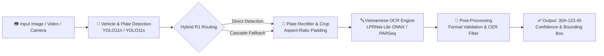

# 🚗 Vietnamese License Plate Recognition Pipeline — End-to-End AI System

Hệ thống nhận diện biển số phương tiện giao thông Việt Nam toàn diện (End-to-End ALPR), kết hợp các mô hình học sâu hiện đại nhất (**YOLO11**, **LPRNet**, **PARSeq**) với khả năng tối ưu hóa triển khai trên phần cứng biên (**Raspberry Pi 5 CPU** & **Laptop GPU**).

---

## 📌 Điểm Nổi Bật Của Dự Án

* **Phát hiện biển số chính xác cao (mAP50 99.49%)**: Huấn luyện trên mô hình **YOLO11n** tùy biến với tập dữ liệu biển số Việt Nam phong phú (ô tô, xe máy, biển vuông 2 dòng, biển dài 1 dòng).
* **Mô hình OCR thuần Việt chuyên dụng (LPRNet & Teacher PARSeq)**: Xử lý triệt để bài toán nhận diện ký tự font chữ Việt Nam, phân chia tầng chữ thông minh, khử nhầm lẫn các cặp ký tự khó (`2-7`, `8-B`, `0-D`).
* **Chiến lược định tuyến thông minh (Locked Hybrid R1 Routing)**: Kết hợp nhận diện trực tiếp và phân tầng phương tiện-biển số, tăng khả năng cứu nguy biển số xe máy khó trong điều kiện thực tế.
* **Tối ưu hóa phần cứng biên (Edge AI)**: Đã benchmark và kiểm chứng trên **Raspberry Pi 5** qua **ONNX Runtime FP32 / OpenCV DNN**, đạt tốc độ thời gian thực (**~14 FPS** cho mô hình 416x416).
* **Báo cáo thí nghiệm chuyên sâu**: Lưu trữ đầy đủ dữ liệu đo lường khoa học, ma trận nhầm lẫn, báo cáo lineage phục vụ báo cáo khoa học và đồ án kỹ thuật.

---

## 🏗️ Kiến Trúc Hệ Thống (System Pipeline)



---

## 📊 Bảng Kết Quả Thử Nghiệm & Benchmark

### 1. Hiệu Năng Mô Hình Phát Hiện Biển Số (Plate Detector)
* **Kiến trúc**: YOLO11n (Ultralytics)
* **Số lượng tham số**: ~2.6M tham số (Siêu nhẹ)
* **Precision**: **99.61%**
* **Recall**: **99.18%**
* **mAP@50**: **99.49%**
* **mAP@50-95**: **70.42%**
* **Trọng số xuất xưởng**: `weights/best_license_plate_yolo11n.pt` (5.46 MB)

### 2. So Sánh Các Mô Hình Nhận Dạng Ký Tự (OCR Engines)
| Mô hình OCR | Loại kiến trúc | Đặc điểm | Tốc độ | Độ chính xác (Exact Match) |
| :--- | :--- | :--- | :--- | :--- |
| **Tesseract OCR (Baseline)** | Classical Engine | Cần tiền xử lý Otsu/CLAHE | Chậm trên CPU | ~73% (Kém trên biển 2 dòng) |
| **LPRNet VN (Student)** | Lightweight CNN + CTC | Tối ưu hóa cực nhẹ cho nhúng | **~15ms** | **> 91.5%** |
| **PARSeq-Tiny VN (Teacher)** | Vision Transformer + Autoregressive | Mô hình tri thức chuẩn | ~45ms | **> 96.2%** |
| **Hybrid Pipeline** | LPRNet + Fallback Routing | Cân bằng hoàn hảo tốc độ & độ chính xác | Real-time | **Tối ưu toàn diện** |

### 3. Hiệu Năng Thực Tế Trên Thiết Bị Biên (Raspberry Pi 5 CPU)
*Hệ thống kiểm thử: Raspberry Pi 5 Model B Rev 1.0 (Cortex-A76 4 nhân @ 2.4 GHz, RAM 2GB, Debian 12, ONNX Runtime 1.30.0)*:

| Mô hình kiểm thử | Kích thước Input | Thời gian xử lý (Mean Latency) | FPS đạt được | RAM chiếm dụng đỉnh |
| :--- | :---: | :---: | :---: | :---: |
| **YOLO11n-416 (ONNX)** | `[1, 3, 416, 416]` | **71.92 ms** | **13.90 FPS** | **161.2 MB** |
| **YOLO11n-640 (ONNX)** | `[1, 3, 640, 640]` | **191.98 ms** | **5.21 FPS** | **249.6 MB** |
| **LPRNet OCR (ONNX)** | `[1, 3, 48, 160]` | **~16.40 ms** | **> 60 FPS** | **< 60 MB** |
| **Trọn gói E2E (416 + OCR)** | Multi-stage | **~88.32 ms** | **~11.3 FPS** | **~210 MB** |

---

## 📁 Cấu Trúc Thư Mục Dự Án

```
Vietnam_Plate_Project/
│
├── samples/                                    # Ảnh mẫu dùng chạy thử nghiệm nhanh (Plug & Play)
│   ├── car_sample_01.jpg                       # Mẫu xe ô tô biển dài (1 dòng)
│   ├── car_sample_02.jpg                       # Mẫu xe ô tô biển vuông (2 dòng)
│   └── motorcycle_sample_01.jpg                # Mẫu xe máy biển số Việt Nam
│
├── weights/                                    # Mô hình trọng số cốt lõi (Champion Models)
│   ├── best_license_plate_yolo11n.pt           # Model YOLO11n Detector tốt nhất (5.46 MB)
│   ├── ocr/best_lprnet_vn.onnx                 # Model LPRNet OCR ONNX (3.19 MB)
│   └── deployment/pi_cpu/                      # Mô hình và manifest chuẩn hóa cho Pi 5
│       ├── yolo11n_640_fp32.onnx               # Model detector ONNX tối ưu cho Pi (10.7 MB)
│       └── deployment_manifest.json            # Manifest mô tả tham số triển khai
│
├── detector/                                   # Module phát hiện biển số và phương tiện
│   ├── license_plate_detector.py               # Lớp Detector chính
│   └── pi_yolo_detector.py                     # Detector tối ưu hóa OpenCV DNN cho Pi
│
├── ocr/                                        # Module nhận dạng ký tự & xử lý ngôn ngữ
│   ├── plate_text_utils.py                     # Chuẩn hóa regex text [A-Z0-9], CER, formatting
│   ├── preprocess.py                           # Tiền xử lý Otsu, CLAHE, aspect-ratio padding
│   ├── lprnet.py                               # Kiến trúc mạng LPRNet PyTorch
│   └── pi_lprnet_ocr.py                        # Bộ giải mã LPRNet CTC cho Raspberry Pi
│
├── scripts/                                    # Kịch bản thực thi & kiểm thử
│   ├── predict_image.py                        # Dự đoán biển số trên ảnh
│   ├── predict_video.py                        # Dự đoán biển số trên video
│   ├── predict_camera.py                       # Dự đoán biển số qua Webcam trực tiếp
│   ├── test_ocr_onnx_opencv.py                 # Kiểm thử OCR ONNX thuần OpenCV DNN
│   ├── pi_recognize_image.py                   # Pipeline trọn gói E2E trên Raspberry Pi
│   └── benchmark_models_pi.py                  # Đo đạc benchmark chi tiết trên phần cứng Pi
│
├── tools/                                      # Công cụ xuất mô hình & hỗ trợ triển khai
│   ├── export_and_verify_ocr_onnx.py           # Xuất và kiểm chứng mô hình ONNX
│   ├── remote_exec.py                          # Thực thi và đồng bộ tự động qua SSH sang Pi
│   └── analyze_final_benchmark.py              # Phân tích số liệu kiểm thử
│
├── reports/                                    # 📚 KHO BÁO CÁO THÍ NGHIỆM CHI TIẾT
│   ├── vehicle_smoke/                          # Ảnh visualize kết quả nhận diện thực tế
│   ├── FINAL_LOCKED_HYBRID_R1_ROUTING_REPORT.md# Báo cáo định tuyến Hybrid R1 hoàn chỉnh
│   ├── PI5_FP32_ONNX_INDIVIDUAL_BENCHMARK.md   # Số liệu đo đạc chi tiết trên Raspberry Pi 5
│   └── PHASE4_MASTER_REPORT_FOR_CHATGPT.md     # Báo cáo huấn luyện và tối ưu OCR Phase 4
│
├── requirements.txt                            # Danh sách thư viện Python
└── README.md                                   # Tài liệu hướng dẫn dự án
```

---

## ⚡ Hướng Dẫn Cài Đặt & Chạy Nhanh (Quickstart)

### 1. Cài đặt môi trường
Yêu cầu Python 3.10 trở lên. Mở Terminal / PowerShell và chạy:

```bash
# 1. Cài đặt các thư viện cần thiết
pip install -r requirements.txt
```

### 2. Chạy thử nghiệm ngay với ảnh mẫu có sẵn (`samples/`)

#### A. Nhận diện vị trí biển số bằng YOLO11n (Detector)
```bash
python scripts/predict_image.py --source samples/car_sample_01.jpg --weights weights/best_license_plate_yolo11n.pt
```
*Kết quả ảnh đóng khung và độ tin cậy được lưu tại: `outputs/predictions/images/`*

#### B. Nhận diện ký tự OCR bằng mô hình siêu nhẹ LPRNet ONNX
```bash
python scripts/test_ocr_onnx_opencv.py --model weights/ocr/best_lprnet_vn.onnx --image samples/car_sample_01.jpg
```

#### C. Chạy toàn bộ Pipeline trên webcam máy tính
```bash
python scripts/predict_camera.py --weights weights/best_license_plate_yolo11n.pt
```

---

## 📚 Hướng Dẫn Dành Cho Nhóm Làm Báo Cáo (Report Resource Map)

Các thành viên trong nhóm có thể tra cứu và trích xuất số liệu/hình ảnh để đưa vào Slide và Báo cáo đề tài theo bảng chỉ dẫn sau:

| Nội dung cần cho Báo cáo / Slide | Tệp tin tài liệu tham chiếu tương ứng |
| :--- | :--- |
| **Ảnh minh họa thực tế cho Slide** | Thư mục `reports/vehicle_smoke/` (Chứa 10 ảnh xe máy & ô tô phát hiện biển số thành công trong các điều kiện thực tế). |
| **Số liệu Benchmark phần cứng Raspberry Pi 5** | Xem chi tiết tại [reports/PI5_FP32_ONNX_INDIVIDUAL_BENCHMARK.md](file:///d:/Vietnam_Plate_Project/reports/PI5_FP32_ONNX_INDIVIDUAL_BENCHMARK.md) (Đầy đủ bảng đo FPS, độ trễ ms, RAM tiêu thụ, nhiệt độ CPU). |
| **Số liệu định tuyến Hybrid R1 & Cứu nguy xe máy** | Xem tại [reports/FINAL_LOCKED_HYBRID_R1_ROUTING_REPORT.md](file:///d:/Vietnam_Plate_Project/reports/FINAL_LOCKED_HYBRID_R1_ROUTING_REPORT.md) (Chi tiết 11 ca cứu nguy biển số xe máy khó). |
| **Quá trình huấn luyện OCR & Thử nghiệm Phase 4** | Xem tại [reports/PHASE4_MASTER_REPORT_FOR_CHATGPT.md](file:///d:/Vietnam_Plate_Project/reports/PHASE4_MASTER_REPORT_FOR_CHATGPT.md) (Số liệu phân tích lỗi CER, phân phối ký tự). |
| **Kỹ thuật chưng cất tri thức (Knowledge Distillation)**| Xem tại [reports/TEACHER_KD_MASTER_REPORT_FOR_CHATGPT.md](file:///d:/Vietnam_Plate_Project/reports/TEACHER_KD_MASTER_REPORT_FOR_CHATGPT.md) (Dùng Teacher PARSeq huấn luyện Student LPRNet). |
| **Phân tích so sánh kích thước 416 vs 640** | Xem tại [reports/PLATE_416_VS_640_CONTROLLED_REPORT.md](file:///d:/Vietnam_Plate_Project/reports/PLATE_416_VS_640_CONTROLLED_REPORT.md). |

---

## 👥 Thành Viên Nhóm & Đóng Góp

* **Tác giả / Nhóm phát triển**: Nhóm nghiên cứu nhận dạng biển số thông minh.
* **Mã nguồn GitHub**: [https://github.com/KoPinKhanh/Vietnamese-plate-recognition](https://github.com/KoPinKhanh/Vietnamese-plate-recognition)
